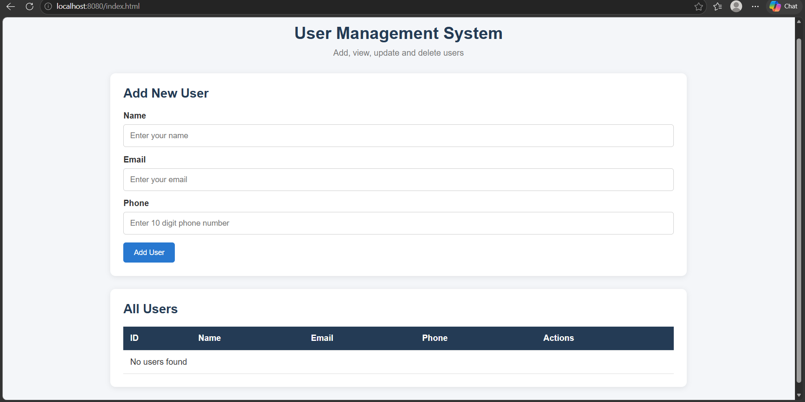

# User Management System

A CRUD-based User Management Application built using Java Spring Boot and MySQL.

## Features
- Add new users
- View all users
- Update user details
- Delete users
- Store user data in MySQL

## Technologies Used
- Java 21
- Spring Boot
- Spring Data JPA
- MySQL
- HTML, CSS, JavaScript
- Maven

## API Endpoints

| Method | Endpoint | Description |
|---|---|---|
| POST | /api/users | Create user |
| GET | /api/users | Get all users |
| GET | /api/users/{id} | Get user by ID |
| PUT | /api/users/{id} | Update user |
| DELETE | /api/users/{id} | Delete user |

## Application Output

## Run Locally

1. Create database `user_management_db` in MySQL.
2. Set the `DB_PASSWORD` environment variable.
3. Open the backend folder in PowerShell.
4. Run `.\mvnw.cmd spring-boot:run`.
5. Open http://localhost:8081/index.html.
